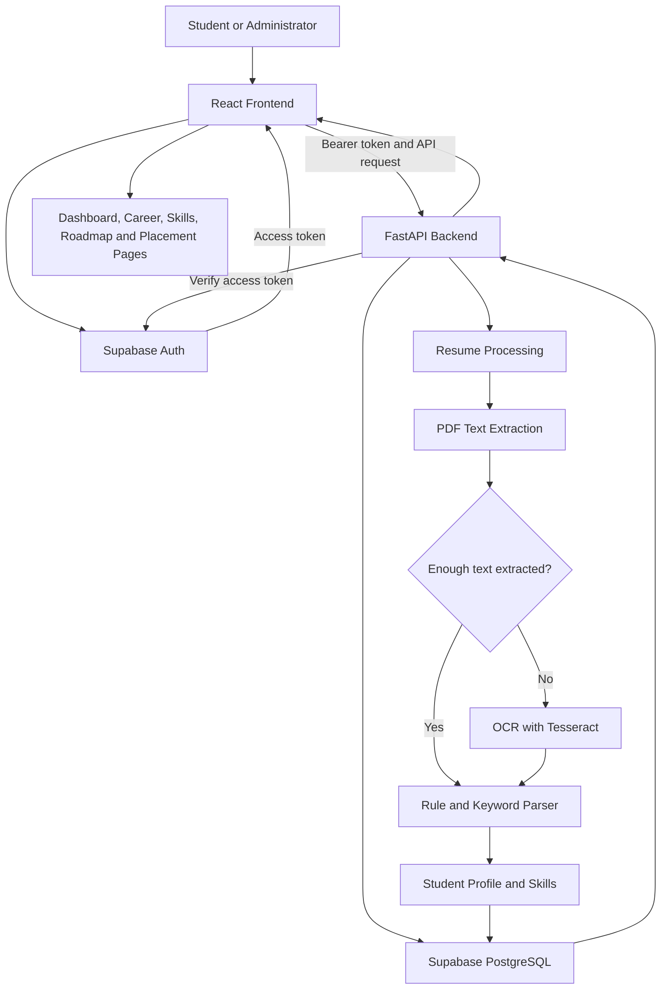
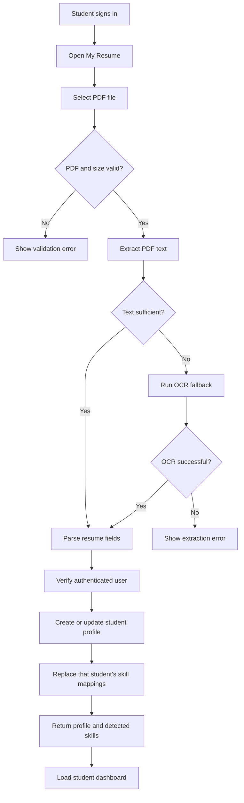

# CareerPilot AI – Project Documentation

**Project title:** CareerPilot AI – AI-Powered Career Guidance & Placement System  
**Project type:** Web-based academic project  
**Repository:** https://github.com/dipali1910/CareerPilot-AI  
**Frontend:** React application hosted on Vercel  
**Backend:** FastAPI service hosted on Render  
**Database and authentication:** Supabase

> **Submission note:** Fill in the college name, department, student name(s), guide name, academic year and certificate/declaration pages according to your college format. This document describes the implementation inspected in the repository branch `fix/multi-user-auth-resume-analysis`. Confirm that this branch is merged and deployed before describing its changes as part of the live production release.

---

## 1. Abstract

CareerPilot AI is a web-based career guidance and placement support platform designed to help students understand their current skills, explore suitable career paths and organize their preparation for employment. Students can register and sign in, upload a PDF resume, and review a profile created from the information extracted from that resume. The platform provides a student dashboard, career analysis, career recommendations, skill-gap information, learning roadmaps, placement opportunities and application tracking. An administrator can review student job applications and update their status.

The application uses a React frontend, a Python FastAPI backend, and Supabase for authentication and database services. Resume processing uses PDF text extraction and an OCR fallback for scanned documents. The current parser applies deterministic rules and keyword matching to identify education details, skills and likely career roles. The dashboard readiness score is calculated using a weighted formula based on profile and project information.

The purpose of the system is to bring useful career preparation information into one application and provide students with a structured view of their career readiness.

## 2. Introduction

Students often maintain their resumes, skills, career plans and job applications in different places. It can be difficult to understand which skills are relevant to a selected career, identify areas that need improvement and keep track of placement activity.

CareerPilot AI aims to provide a single platform for these activities. It processes a student's resume, builds a student-specific profile and presents career preparation information through a dashboard and dedicated modules.

The platform supports separate authenticated student accounts. Student records are associated with the authenticated account so that one student's resume-derived profile is not intentionally reused as another student's profile.

## 3. Problem statement

Students may face the following challenges:

- They may not know which career roles align with their education and skills.
- They may not clearly understand the difference between their existing skills and the skills expected for a target role.
- Resume information may need to be reviewed and organized manually.
- Learning plans and placement preparation can be difficult to track.
- Job applications and their statuses may be spread across different platforms.

The project addresses these challenges by combining resume parsing, profile-based career information, skill-gap visibility, roadmaps and application tracking in one web application.

## 4. Objectives

1. Provide secure account registration and login for students.
2. Allow a student to upload a PDF resume.
3. Extract available resume text and identify selected profile attributes.
4. Create or update a profile associated with the authenticated student.
5. Present profile information and readiness metrics on a dashboard.
6. Display career recommendations and skill-gap information associated with the student.
7. Provide a learning roadmap and placement opportunity views.
8. Allow students to submit and track job applications.
9. Allow authorized administrators to review applications and update their status.

## 5. Scope

### 5.1 Included in the current implementation

- Email/password authentication through Supabase Auth.
- Student and administrator application routes.
- PDF resume upload with a 5 MB size limit.
- Text extraction from text-based PDFs.
- OCR fallback for scanned/image-based PDFs, subject to OCR availability on the server.
- Rule-based extraction of education, location, career-role and skill information.
- Student dashboard and readiness calculation.
- Career analysis and recommendation views backed by student-specific database records.
- Skill-gap and roadmap views.
- Placement opportunities, job-match details and application tracking.
- Administrator application review and status updates.

### 5.2 Outside the verified scope

The inspected code does not establish that the application currently uses a large language model or generative AI service for resume interpretation. It also does not establish automatic live job-feed synchronization, automated email notifications, or a production-grade machine-learning recommendation model. These should be treated as possible future enhancements unless separately implemented and tested.

## 6. Existing system and proposed system

### Existing approach

A student may need to read a resume manually, search for career options independently, identify missing skills and maintain application records separately. This can make career preparation fragmented and time-consuming.

### Proposed approach

CareerPilot AI combines the main activities in one application:

- Authenticate the student.
- Process the student's resume.
- Create or update the student's profile.
- Present profile-specific dashboard information.
- Show career recommendations and skill gaps associated with that profile.
- Provide roadmap and placement modules.
- Track job applications.

## 7. Technology stack

| Layer | Technology | Purpose |
|---|---|---|
| Frontend | React 19 | Component-based user interface |
| Build and development | Vite 8 | Frontend development server and production build |
| Routing | React Router 7 | Navigation between application pages |
| Styling | Tailwind CSS 4 | UI styling |
| Backend | Python and FastAPI | REST API and server-side business logic |
| API server | Uvicorn | Runs the FastAPI application |
| Data validation | Pydantic | Request/data validation support |
| Authentication | Supabase Auth | Email/password user authentication and access tokens |
| Database | Supabase PostgreSQL | Stores user, student, skill, career and application data |
| PDF text extraction | pypdf | Extracts text from PDF documents |
| PDF rendering | PyMuPDF | Renders scanned PDF pages for OCR |
| OCR | Tesseract and pytesseract | Extracts text from image-based PDF pages |
| Image processing | Pillow | Prepares page images for OCR |
| Deployment | Vercel and Render | Hosts the frontend and backend |

## 8. System architecture

The application follows a frontend–backend–database architecture.

### Architecture explanation

1. The user interacts with the React frontend.
2. Supabase Auth handles account registration and login.
3. The frontend obtains an access token for the authenticated session.
4. Protected API requests send the token in the Authorization Bearer header.
5. FastAPI verifies the token with Supabase Auth.
6. The backend processes the requested operation and accesses the database.
7. For resume uploads, the backend extracts PDF text, uses OCR when required and parses supported fields.
8. Student-specific information is stored or retrieved using the authenticated account's database relationship.
9. The backend returns data to the frontend for display.

## 9. Main application modules

### 9.1 Authentication module

Provides registration, login and password recovery screens. Supabase Auth manages email/password authentication. The backend validates access tokens before returning protected student data.

The project can be configured to disable email confirmation in Supabase when immediate signup is required. This is a Supabase project setting.

### 9.2 Resume upload and parsing module

The student uploads a PDF resume. The backend:

1. Checks that the file is a PDF.
2. Rejects an empty file.
3. Enforces a maximum upload size of 5 MB.
4. Attempts text extraction using pypdf.
5. If the extracted text is insufficient, attempts OCR using PyMuPDF, Tesseract and Pillow.
6. Applies deterministic text and keyword rules to identify supported profile information.
7. Creates or updates the authenticated student's profile and skill mappings.

The inspected parser attempts to identify:

- Name fallback, using account metadata or resume text.
- Degree.
- Specialization.
- Graduation year.
- CGPA/GPA when present.
- Location when a supported location pattern or city is found.
- Likely target career role.
- Experience duration when it matches the supported text pattern.
- Skills that match the application's existing skills catalogue.

**Important:** Parsing depends on the resume's formatting and wording. Extracted values should be reviewed by the student. Missing or ambiguous information may not be detected correctly.

### 9.3 Student profile module

The profile is associated with the authenticated Supabase user ID. The backend uses the verified session's account ID and email rather than treating a submitted email or user ID as proof of identity.

The student record contains the education and career fields used by the application. Skill mappings connect the student profile with entries in the skills catalogue.

### 9.4 Dashboard module

The dashboard presents a summary of the student's profile, detected skills, career recommendation count and placement-readiness score.

The dashboard data is retrieved for the authenticated student. It should not display another account's profile information.

### 9.5 Career analysis module

The career analysis endpoint returns the student's profile, skills, projects, career recommendations, skill gaps, a summary and readiness metrics.

The current summary is generated using predefined text based on the student's target role. It is not evidence of a generative AI response.

### 9.6 Career recommendations module

The application retrieves career recommendations associated with the student's profile and orders them by match score. It also returns strengths, missing skills and suggested actions based on the available skill-gap records.

The quality of recommendations depends on the recommendation records and matching data maintained in the database.

### 9.7 Skill-gap module

Displays skills identified as gaps for the student, including current level, required level and priority when those values are available in the database.

### 9.8 Learning roadmap module

Provides roadmap information and roadmap-item updates so that students can organize learning activities.

### 9.9 Placement opportunities and job-match module

Provides placement opportunities and job-match details to help students review available roles.

### 9.10 Job application and tracking module

Students can submit job applications and view their application records. The administrator module provides access to review applications and update application status. Administrator access is checked against the user's role in the application database.

## 10. Resume processing workflow

## 11. Database design

The backend code references the following Supabase tables. The descriptions below explain their observed purpose from the application queries; exact column types, constraints, indexes and foreign-key definitions should be confirmed against the live Supabase schema before submitting a formal ER diagram.

| Table | Observed purpose |
|---|---|
| `users` | Application user identity, name, email and role |
| `students` | Student profile and education/career attributes |
| `skills` | Catalogue of available skills |
| `student_skills` | Relationship between a student and detected skills, including proficiency |
| `projects` | Student project information used in analysis and readiness |
| `career_roles` | Career role catalogue |
| `career_recommendations` | Career recommendations associated with a student |
| `skill_gaps` | Student-specific skill gap records |
| `roadmaps` | Learning roadmap records |
| `roadmap_items` | Individual roadmap activities |
| `jobs` | Placement/job opportunity records |
| `companies` | Company information associated with jobs |
| `job_required_skills` | Skills associated with job requirements |
| `applications` | Student job application records and statuses |

### Key data relationships observed in backend queries

- A student profile is looked up using `students.user_id`, which corresponds to the authenticated application user's ID.
- Skill mappings are retrieved using `student_skills.student_id` and joined to the `skills` catalogue.
- Projects, career recommendations and skill gaps are filtered by the relevant `student_id`.
- Job applications are associated with student/job information in the application workflow.
- Administrator access is based on the role stored in the `users` table.

### Multi-user data isolation

The backend verifies the Supabase access token and obtains the authenticated account ID from the verified session. Student endpoints resolve the corresponding user and student profile from that identity. This is intended to prevent a client from selecting another student's profile simply by changing an email or user ID in a request.

The backend uses a server-side Supabase service-role key for database operations. This key must remain on the server and must never be included in frontend environment variables or browser code. Database-level Row Level Security policies should also be reviewed before production use.

## 12. Readiness score calculation

The backend calculates a readiness score from four weighted components:

| Component | Weight |
|---|---:|
| Technical skills | 40% |
| Project strength | 25% |
| Role alignment | 20% |
| Education | 15% |
| **Total** | **100%** |

The implementation uses these calculations:

- **Technical skills:** Average proficiency score across detected skills. The current mapping uses Beginner/Basic = 40, Intermediate = 70, Advanced = 90 and Expert = 100. Unknown proficiency values default to 50.
- **Project strength:** 25 points per project, capped at 100.
- **Role alignment:** 100 when a target role is detected and is not a fallback value; otherwise 25.
- **Education:** CGPA multiplied by 10 and clamped between 0 and 100. If CGPA is missing or invalid, the score is 0.
- **Overall score:** 40% technical skills + 25% project strength + 20% role alignment + 15% education, rounded and clamped to 0–100.

This is a project-defined heuristic score, not a validated prediction of employment probability or placement outcome.

## 13. Backend API overview

All student-specific endpoints below require an authenticated Bearer token in the Authorization header. The backend derives the student identity from the verified token.

| Method | Endpoint | Purpose |
|---|---|---|
| GET | `/` | API status message |
| GET | `/health` | Health check |
| GET | `/api/db-test` | Admin-only database test |
| POST | `/api/student/resume-upload` | Upload and parse a PDF resume |
| GET | `/api/student/dashboard` | Retrieve the student's dashboard data |
| GET | `/api/student/career-analysis` | Retrieve career analysis and readiness breakdown |
| GET | `/api/student/career-recommendations` | Retrieve career recommendations |
| GET | `/api/student/placement-opportunities` | Retrieve placement opportunities |
| GET | `/api/student/job-match/{job_id}` | Retrieve a job-match detail |
| GET | `/api/student/skill-gaps` | Retrieve skill gaps |
| GET | `/api/student/roadmap` | Retrieve learning roadmap |
| PATCH | `/api/student/roadmap-item` | Update a roadmap item |
| POST | `/api/student/applications` | Submit a job application |
| GET | `/api/student/applications` | Retrieve the student's applications |
| GET | `/api/admin/applications` | Admin-only application listing |
| PATCH | `/api/admin/applications/{application_id}/status` | Admin-only application status update |

The exact request and response schemas can be inspected through FastAPI's interactive documentation at `/docs` when the backend is running.

## 14. Functional requirements

1. The system shall allow a user to register and sign in.
2. The system shall authenticate protected API requests.
3. The system shall allow an authenticated student to upload a PDF resume within the file-size limit.
4. The system shall attempt text extraction and OCR fallback where required.
5. The system shall create or update the profile associated with the authenticated user.
6. The system shall show the student's own dashboard information.
7. The system shall display available career recommendations and skill-gap records for the student.
8. The system shall allow students to view roadmaps and placement opportunities.
9. The system shall allow students to submit and track job applications.
10. The system shall restrict application administration functions to authorized administrators.

## 15. Non-functional requirements

- **Security:** Validate access tokens and protect server-side credentials.
- **Privacy:** Keep student records associated with the correct authenticated account.
- **Usability:** Provide clear navigation and understandable validation feedback.
- **Reliability:** Handle invalid, empty, oversized or unreadable resume files with errors.
- **Performance:** Keep resume uploads within the defined size limit and avoid unnecessary processing.
- **Maintainability:** Separate frontend pages, backend API logic and database responsibilities.
- **Compatibility:** Support modern desktop and mobile browsers, subject to UI testing.
- **Availability:** Depend on the configured Vercel, Render and Supabase services.

## 16. Testing plan and test cases

The following cases should be executed and recorded before final submission. A test is not considered passed merely because the relevant screen exists.

| Test ID | Test scenario | Expected result |
|---|---|---|
| TC-01 | Register a new student account | Account is created successfully |
| TC-02 | Sign in with valid credentials | User reaches the application |
| TC-03 | Sign in with an invalid password | Authentication error is shown |
| TC-04 | Upload a valid text-based PDF | Resume text is extracted and profile data is returned |
| TC-05 | Upload a scanned PDF | OCR is attempted and text is extracted if readable and OCR is available |
| TC-06 | Upload a non-PDF or oversized file | File is rejected with a clear error |
| TC-07 | Upload a resume for Student A | Student A's profile is created or updated |
| TC-08 | Sign in as Student B and upload a different resume | Student B's profile is created or updated independently |
| TC-09 | Switch between Student A and Student B | Each account sees its own name and profile information |
| TC-10 | Request a protected endpoint without a valid token | Request is rejected |
| TC-11 | Open admin application routes as a non-admin | Access is denied |
| TC-12 | Update a roadmap item | The change is reflected when data is reloaded |
| TC-13 | Submit and view a job application | The student's application appears in tracking |
| TC-14 | Build the frontend for production | Vite build completes without errors |

### Critical multi-user acceptance test

Use two genuinely different test accounts and two clearly different resumes:

1. Register Student A and upload Resume A.
2. Verify the displayed account name, education, skills and target role.
3. Sign out.
4. Register or sign in as Student B and upload Resume B.
5. Verify Student B's details are different where the resumes differ.
6. Sign out and sign in again as Student A.
7. Confirm Student A's information remains unchanged.
8. Confirm neither student can retrieve the other's profile through the normal student interface.

Record screenshots and actual results for the report. Do not mark tests as passed until they have been performed.

## 17. Deployment

The application is split into two deployed services:

- **Frontend:** Vercel – https://career-pilot-ai-six-brown.vercel.app
- **Backend:** Render – https://careerpilot-ai-backend-docker.onrender.com
- **Database and authentication:** Supabase project configured for CareerPilot AI.

The frontend must use the correct deployed backend URL. The backend must have its required Supabase environment variables configured in Render. The frontend's Supabase URL and publishable key must be configured in Vercel. The service-role key must only exist in the backend environment.

The deployment URLs are project configuration references; their live availability should be checked immediately before the demonstration.

## 18. Limitations

- Resume parsing is rule- and keyword-based and may miss information when resumes use unusual formats or wording.
- OCR requires Tesseract to be installed and available in the backend environment.
- The parser only extracts a limited set of structured fields.
- Readiness scoring is a heuristic and is not a scientifically validated placement prediction.
- Recommendation quality depends on the data already present in the database.
- The generated career-analysis summary uses predefined text rather than a generative AI model.
- Resume content may contain sensitive personal information; access control, retention and deletion practices should be reviewed before real-world use.
- A live production release requires verification that the latest reviewed branch has been merged and deployed.

## 19. Future enhancements

1. Integrate a properly evaluated AI/LLM service for richer resume understanding and explainable career guidance.
2. Improve resume parsing with stronger entity extraction and support for more resume formats.
3. Allow students to review and correct extracted profile fields.
4. Improve career matching with a documented scoring model and transparent match explanations.
5. Add resume version history and secure document storage with retention controls.
6. Add verified job-feed integrations and notifications.
7. Add analytics for administrators and placement coordinators.
8. Add automated unit, integration and end-to-end tests.
9. Review and enforce database Row Level Security policies.
10. Add accessibility and performance testing.

## 20. Conclusion

CareerPilot AI brings student authentication, resume processing, profile creation, career information, skill-gap visibility, learning roadmaps and placement application tracking into one web-based platform. Its React frontend, FastAPI backend and Supabase services provide a modular foundation for further development.

The current implementation demonstrates a practical workflow for extracting selected information from PDF resumes and using student-specific records to present career preparation information. Further improvements to parsing accuracy, recommendation quality, automated testing, security policies and AI integration can strengthen the system for broader use.

## 21. References

- React documentation: https://react.dev/
- Vite documentation: https://vite.dev/
- React Router documentation: https://reactrouter.com/
- Tailwind CSS documentation: https://tailwindcss.com/docs
- FastAPI documentation: https://fastapi.tiangolo.com/
- Supabase documentation: https://supabase.com/docs
- pypdf documentation: https://pypdf.readthedocs.io/
- PyMuPDF documentation: https://pymupdf.readthedocs.io/
- Tesseract OCR documentation: https://tesseract-ocr.github.io/

---

## Appendix A – Details to complete for college submission

- College / University: **[Enter institution name]**
- Department: **[Enter department]**
- Student name(s): **[Enter name(s) and roll number(s)]**
- Project guide: **[Enter guide name]**
- Academic year: **[Enter academic year]**
- Project type / semester: **[Enter details required by college]**

## Appendix B – Screenshots to insert

Add actual screenshots from the running application with captions:

1. Login page.
2. Registration page.
3. Resume upload page.
4. Successful resume analysis/profile result.
5. Student dashboard.
6. Career analysis page.
7. Career recommendations page.
8. Skill-gap page.
9. Learning roadmap page.
10. Placement opportunities page.
11. Job-match detail page.
12. Application tracking page.
13. Administrator application management page.

Use screenshots from the current deployed build. Hide personal email addresses, access tokens, passwords and other private information before inserting them into the report.
